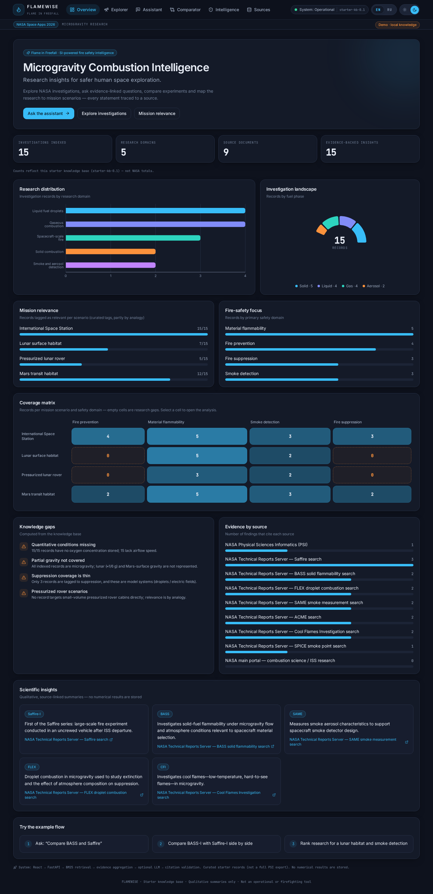
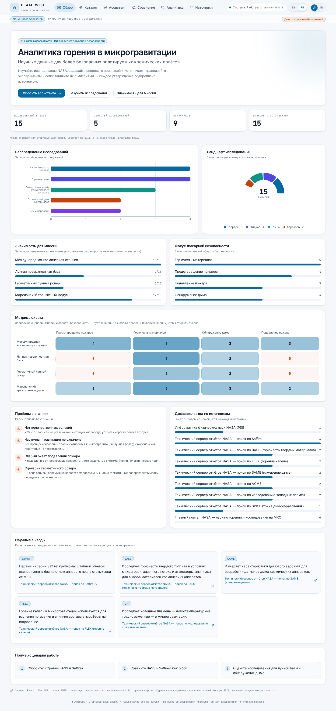
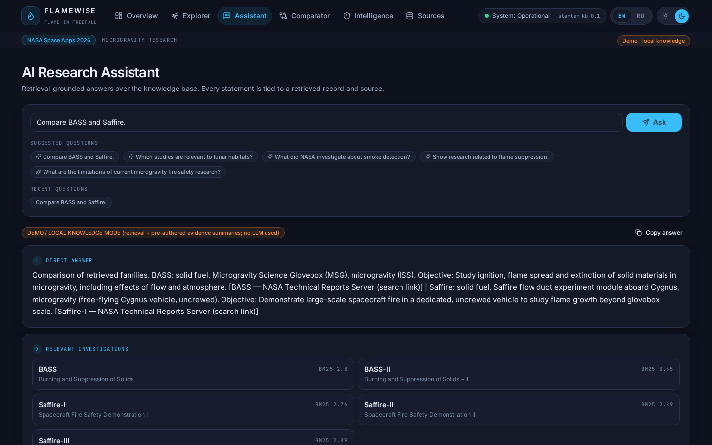
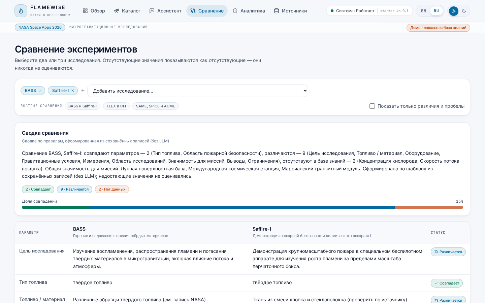
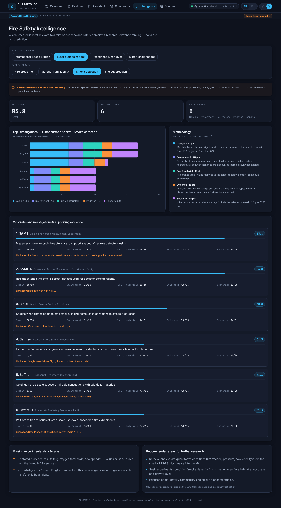
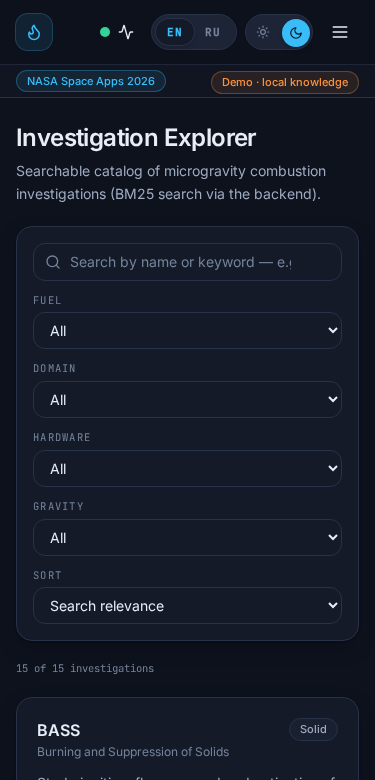

<div align="center">

# 🔥 FLAMEWISE

**Flame in Freefall — SI-powered fire safety intelligence**

*Turning microgravity combustion research into actionable fire safety intelligence.*


**English** · [Русский](README.ru.md)

</div>

> Built for the **NASA Space Apps Challenge 2026**. FLAMEWISE helps aerospace engineers, fire-safety researchers and students find, compare and interpret NASA microgravity combustion investigations (BASS, Saffire, FLEX, SAME, ACME, CFI, SPICE, SLICE, E-FIELD Flames) — with every statement traced to a source.

---

## ✨ Features

| Module | What it does |
| --- | --- |
| **Mission Overview** | KPIs and charts computed from the real knowledge base, a scenario × safety-domain **coverage matrix** that exposes research gaps, evidence-per-source meters, curated insights. |
| **Investigation Explorer** | Debounced BM25 search, filters (fuel, domain, hardware, gravity), sorting, detail pages with conditions, findings, limitations, related records and previous/next navigation. |
| **AI Research Assistant** | Retrieval-grounded answers in a fixed 7-section structure with citations. Works with no API key (clearly labelled **Demo / local knowledge mode**); optional OpenAI / Anthropic synthesis with citation validation. |
| **Experiment Comparator** | Compare 2–3 investigations; every parameter is marked *same*, *different* or *missing*; match ratio; “differences only” view; shareable URLs. |
| **Fire Safety Intelligence** | Transparent 0–100 **research relevance score** for a mission scenario × safety domain, with per-dimension contributions, methodology, gaps and recommendations. |
| **Data Sources** | Every source used, its type and how many findings cite it. |

**Product shell:** top navigation with mobile sheet · light / dark themes (persisted, no flash) · EN / RU interface with a typed dictionary · accessible dialog and toasts · skeleton loaders · reduced-motion support.

## 🔬 Scientific honesty

FLAMEWISE is deliberately conservative:

- The knowledge base is a **curated starter set** (15 records, 9 sources) — **not** a PSI export.
- **No numerical experimental results are stored.** Unknown values are `null` and shown as *missing*; nothing is estimated.
- Source links point to the NASA PSI / nasa.gov portals and **NTRS search queries**, not to specific papers.
- Mission-relevance tags and score weights are the authors’ **contextual assumptions**, not NASA statements.
- The relevance score is **not** a probability of fire, ignition or material failure, and the app gives no operational firefighting guidance.

## 📸 Screenshots

| Overview (dark) | Overview (light, RU) |
| --- | --- |
|  |  |

| Assistant (dark) | Comparator (light, RU) |
| --- | --- |
|  |  |

| Fire Safety Intelligence (dark) | Explorer (mobile) |
| --- | --- |
|  |  |

*Screenshots were captured from the running app with headless Chromium. Re-capture them after visual changes.*

## 🏗️ Architecture

```
React + Vite (TypeScript, Tailwind, Recharts)
   │  hash routing · I18nProvider · ThemeProvider · ToastProvider
   │  fetch /api/*?lang=en|ru  (Vite dev proxy → :8000)
   ▼
FastAPI + Pydantic
   ├─ data_loader   → data/investigations.json, data/sources.json (English, canonical)
   ├─ i18n_data     → Russian overlay (data/i18n_ru_*.json), verified at startup
   ├─ retrieval     → BM25 + synonyms (+ Russian stem → English term mapping)
   ├─ assistant     → select → aggregate evidence → optional LLM → validate citations
   ├─ compare       → per-parameter same / different / missing (language-independent)
   └─ scoring       → transparent relevance score (5 weighted dimensions)
```

Design notes: English is the canonical data; structural codes (`fuel_type`, `fire_safety_domain`, scenario keys) are never translated — the UI maps codes to labels. Comparison status is computed on canonical values, so switching language can never change a result.

## 🧰 Technology stack

| Layer | Technology |
| --- | --- |
| Frontend | React 18, Vite 5, TypeScript 5, Tailwind CSS 3, Recharts 2, Lucide React |
| Backend | Python 3, FastAPI, Pydantic 2, Uvicorn, httpx |
| Retrieval | In-process BM25 (no external services) |
| LLM (optional) | OpenAI Chat Completions or Anthropic Messages, via environment variables |
| Tests | pytest (API + data integrity); TypeScript strict type-check |

## 🚀 Getting started

**Requirements:** Python 3.10+ and Node.js 18+.

```bash
# 1 — backend (terminal 1)
cd backend
python3 -m venv .venv && source .venv/bin/activate
pip install -r requirements.txt
uvicorn app.main:app --reload --port 8000

# 2 — frontend (terminal 2)
cd frontend
npm install
npm run dev          # http://localhost:5173  (proxies /api → :8000)
```

Open <http://localhost:5173>. Interactive API docs: <http://localhost:8000/docs>.

## ⚙️ Configuration

The app runs without any configuration. Optionally enable live LLM synthesis by exporting variables **before** starting uvicorn (see [`.env.example`](.env.example)):

| Variable | Purpose | Default |
| --- | --- | --- |
| `OPENAI_API_KEY` | Enables OpenAI synthesis (takes priority) | unset |
| `OPENAI_MODEL` | OpenAI model | `gpt-4o-mini` |
| `ANTHROPIC_API_KEY` | Enables Anthropic synthesis | unset |
| `ANTHROPIC_MODEL` | Anthropic model | `claude-3-5-haiku-latest` |

If a key is set but the call fails, the assistant falls back to the local answer and reports the failure to the user — it never pretends an LLM answered. The backend does not load `.env` files itself; export the variables in your shell.

## 🧭 Usage

1. **Overview** → open the *coverage matrix*; empty (dashed) cells are research gaps. Click a cell to open the matching analysis.
2. **Assistant** → try a suggested question, e.g. *“Compare BASS and Saffire.”* Switching language re-asks the question in the new language.
3. **Comparator** → pick 2–3 investigations or a quick comparison; the URL can be shared.
4. **Intelligence** → choose a scenario and a safety domain; read the methodology before trusting the ranking.

## 🔌 API

All GET endpoints and POST bodies accept `lang` (`en` | `ru`, default `en`); other values return `422`.

| Method | Endpoint | Description |
| --- | --- | --- |
| GET | `/api/health` | Status, dataset version, LLM mode |
| GET | `/api/overview` | KPIs, distributions, coverage matrix, gaps |
| GET | `/api/investigations` | All investigations |
| GET | `/api/investigations/{id}` | One investigation (`404` if unknown) |
| GET | `/api/sources` | Source documents |
| GET | `/api/insights` | Evidence-linked insights |
| POST | `/api/search` | BM25 search `{query, limit}` |
| POST | `/api/assistant` | Structured answer `{question}` |
| POST | `/api/compare` | Compare `{ids: [2–3 ids]}` |
| POST | `/api/risk-analysis` | Relevance ranking `{scenario, domain}` |

## 🗂️ Project structure

```
.
├── backend/
│   ├── app/            # FastAPI app, retrieval, scoring, localization
│   ├── data/           # investigations.json, sources.json, i18n_ru_*.json
│   ├── tests/          # pytest suite
│   └── requirements*.txt
├── frontend/
│   └── src/
│       ├── components/ # TopBar, Switchers, Dialog, Toast, charts, ui
│       ├── i18n/       # en.ts (source of truth), ru*.ts, provider
│       ├── views/      # one file (or a small group) per screen
│       ├── api.ts  nav.ts  theme.tsx  index.css
├── docs/screenshots/
├── .env.example
├── README.md  README.ru.md
```

## 🛠️ Development

```bash
# backend tests (from /backend)
pip install -r requirements-dev.txt
python -m pytest -q

# frontend (from /frontend)
npm run typecheck    # strict TypeScript — also verifies every RU key exists
npm run build
```

- **Add a UI string:** add the key to `frontend/src/i18n/en.ts`, then to the matching `ru_*.ts` file — the compiler rejects a missing Russian key.
- **Add an investigation:** add it to `investigations.json`, its Russian text to `data/i18n_ru_records_*.json`, and sources to `sources.json`. The backend refuses to start if a reference or translation is missing.
- **Theme tokens** live in `frontend/src/index.css` as RGB triplets; chart colours in `theme.tsx`.

There is currently no ESLint configuration; `npm run typecheck` is the static check.

## 🗺️ Roadmap

- [ ] Extract quantitative conditions (O₂ fraction, pressure, flow) from cited NTRS / PSI documents, with per-value provenance
- [ ] Link individual papers and PSI datasets instead of NTRS search queries
- [ ] Partial-gravity (lunar / Martian) coverage once sources are available
- [ ] Optional semantic (embedding) retrieval alongside BM25
- [ ] Frontend component tests and CI

## 🤝 Contributing

Contributions are welcome. Please:

1. Open an issue describing the change.
2. Keep scientific claims **sourced** — never add unsourced numbers; use `null` for unknown values.
3. Run `python -m pytest -q` and `npm run typecheck` before submitting.
4. Provide both English and Russian text for anything user-facing.

## 📄 License

**No license file is present in this repository**, so no open-source license is granted yet. Add a `LICENSE` file before redistributing or accepting outside contributions.

## 🙏 Acknowledgements

Research context comes from publicly described NASA investigations and the NASA Physical Sciences Informatics (PSI) and NTRS portals. FLAMEWISE is an independent project and is **not affiliated with or endorsed by NASA**.

<div align="center"><sub>Not an operational or firefighting tool.</sub></div>
