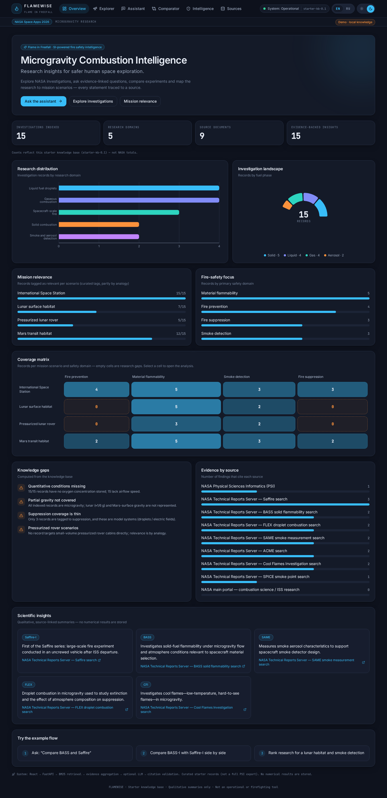
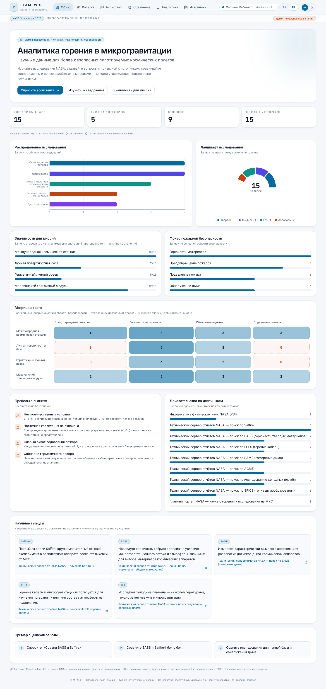
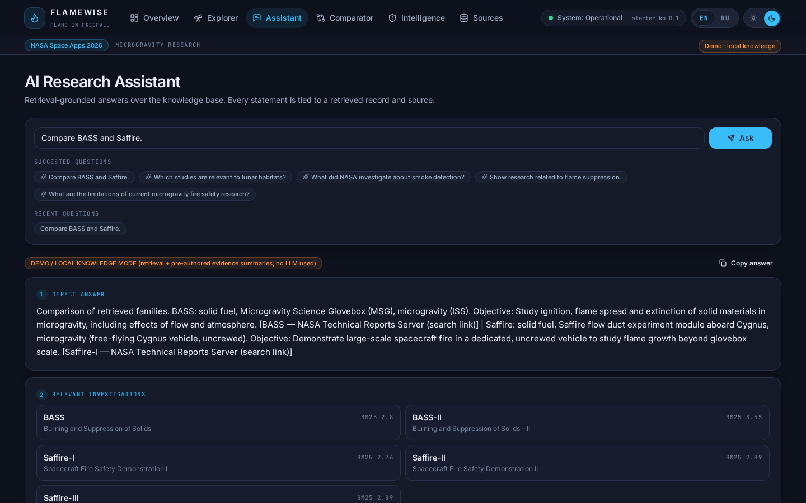
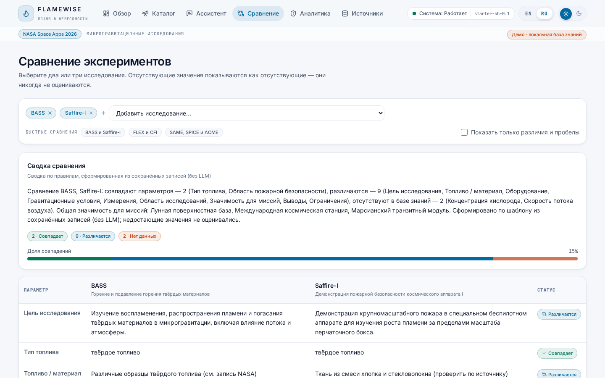
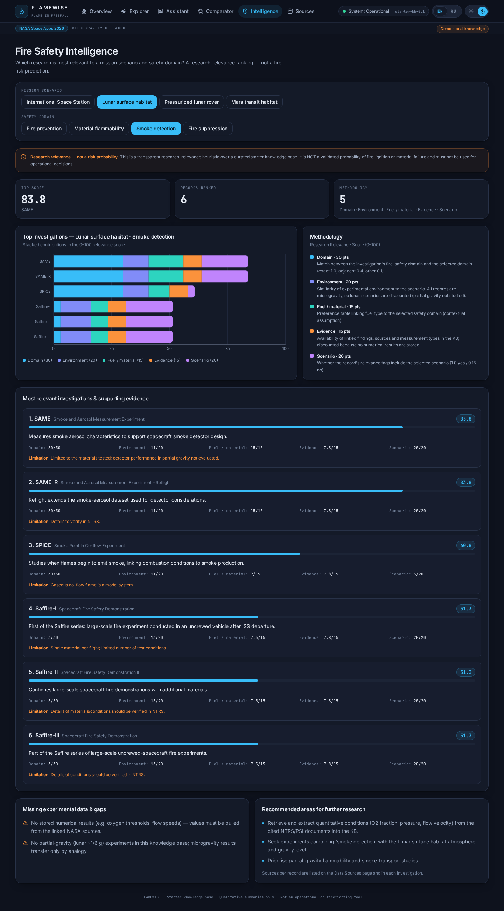
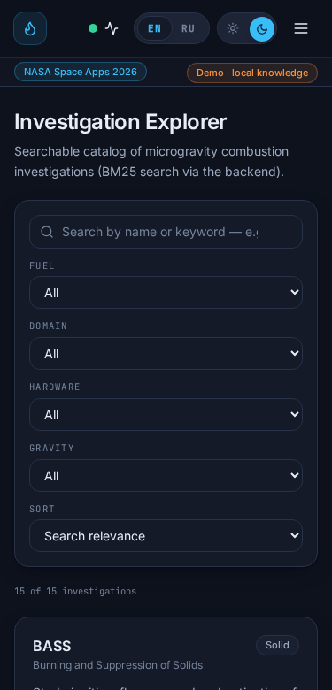

<div align="center">

# 🔥 FLAMEWISE

**Пламя в невесомости — ИИ-аналитика пожарной безопасности**

*Превращаем исследования горения в микрогравитации в практичные данные для пожарной безопасности.*


[English](README.md) · **Русский**

</div>

> Проект создан для **NASA Space Apps Challenge 2026**. FLAMEWISE помогает инженерам, исследователям пожарной безопасности и студентам находить, сравнивать и интерпретировать исследования горения NASA в микрогравитации (BASS, Saffire, FLEX, SAME, ACME, CFI, SPICE, SLICE, E-FIELD Flames) — каждое утверждение привязано к источнику.

---

## ✨ Возможности

| Модуль | Что делает |
| --- | --- |
| **Обзор миссии** | KPI и графики, рассчитанные по реальной базе знаний; **матрица охвата** «сценарий × область безопасности», показывающая пробелы; доказательства по источникам; кураторские выводы. |
| **Каталог исследований** | Поиск BM25 с задержкой ввода, фильтры (топливо, область, оборудование, гравитация), сортировка, страницы исследований с условиями, выводами, ограничениями, связанными записями и переходом вперёд/назад. |
| **ИИ-ассистент** | Ответы на основе поиска в фиксированной структуре из 7 разделов с цитатами. Работает без API-ключа (явно помечено как **демо / локальный режим базы знаний**); опциональный синтез OpenAI / Anthropic с проверкой цитат. |
| **Сравнение экспериментов** | Сравнение 2–3 исследований; каждый параметр помечен как *совпадает*, *различается* или *нет данных*; доля совпадений; режим «только различия»; ссылки, которыми можно делиться. |
| **Аналитика пожарной безопасности** | Прозрачная **оценка исследовательской релевантности** 0–100 для сценария миссии и области безопасности: вклад каждого измерения, методика, пробелы и рекомендации. |
| **Источники данных** | Все использованные источники, их тип и число выводов, которые на них ссылаются. |

**Оболочка продукта:** верхняя навигация с мобильным меню · светлая и тёмная темы (сохраняются, без мигания) · интерфейс EN / RU с типизированным словарём · доступные диалог и уведомления · скелетоны загрузки · поддержка `prefers-reduced-motion`.

## 🔬 Научная честность

FLAMEWISE намеренно консервативен:

- База знаний — **кураторский стартовый набор** (15 записей, 9 источников), а **не** экспорт PSI.
- **Числовые результаты экспериментов не хранятся.** Неизвестные значения равны `null` и показываются как *нет данных*; ничего не оценивается.
- Ссылки ведут на порталы NASA PSI / nasa.gov и на **поисковые запросы NTRS**, а не на конкретные статьи.
- Теги значимости для миссий и веса оценки — **контекстные допущения** авторов, а не утверждения NASA.
- Оценка релевантности **не** является вероятностью пожара, возгорания или отказа материала; приложение не даёт оперативных инструкций по тушению.

## 📸 Скриншоты

| Обзор (тёмная тема) | Обзор (светлая, RU) |
| --- | --- |
|  |  |

| Ассистент (тёмная) | Сравнение (светлая, RU) |
| --- | --- |
|  |  |

| Аналитика пожарной безопасности (тёмная) | Каталог (мобильная версия) |
| --- | --- |
|  |  |

*Скриншоты сняты с запущенного приложения в headless Chromium. Переснимайте их после визуальных изменений. Часть снимков сделана с англоязычным интерфейсом.*

## 🏗️ Архитектура

```
React + Vite (TypeScript, Tailwind, Recharts)
   │  hash-маршрутизация · I18nProvider · ThemeProvider · ToastProvider
   │  fetch /api/*?lang=en|ru  (dev-прокси Vite → :8000)
   ▼
FastAPI + Pydantic
   ├─ data_loader   → data/investigations.json, data/sources.json (английский, канонический)
   ├─ i18n_data     → русский слой (data/i18n_ru_*.json), проверяется при запуске
   ├─ retrieval     → BM25 + синонимы (+ сопоставление русских основ с английскими терминами)
   ├─ assistant     → отбор → агрегация доказательств → опциональная LLM → проверка цитат
   ├─ compare       → по каждому параметру: совпадает / различается / нет данных (не зависит от языка)
   └─ scoring       → прозрачная оценка релевантности (5 взвешенных измерений)
```

Принципы: английский — канонические данные; структурные коды (`fuel_type`, `fire_safety_domain`, ключи сценариев) не переводятся — интерфейс сопоставляет коды с подписями. Статус сравнения считается по каноническим значениям, поэтому смена языка не может изменить результат.

## 🧰 Технологический стек

| Слой | Технологии |
| --- | --- |
| Frontend | React 18, Vite 5, TypeScript 5, Tailwind CSS 3, Recharts 2, Lucide React |
| Backend | Python 3, FastAPI, Pydantic 2, Uvicorn, httpx |
| Поиск | BM25 внутри процесса (без внешних сервисов) |
| LLM (опционально) | OpenAI Chat Completions или Anthropic Messages через переменные окружения |
| Тесты | pytest (API и целостность данных); строгая проверка типов TypeScript |

## 🚀 Быстрый старт

**Требования:** Python 3.10+ и Node.js 18+.

```bash
# 1 — бэкенд (терминал 1)
cd backend
python3 -m venv .venv && source .venv/bin/activate
pip install -r requirements.txt
uvicorn app.main:app --reload --port 8000

# 2 — фронтенд (терминал 2)
cd frontend
npm install
npm run dev          # http://localhost:5173  (проксирует /api → :8000)
```

Откройте <http://localhost:5173>. Интерактивная документация API: <http://localhost:8000/docs>.

## ⚙️ Конфигурация

Приложение работает без настройки. Живой синтез LLM включается переменными окружения, заданными **до** запуска uvicorn (см. [`.env.example`](.env.example)):

| Переменная | Назначение | По умолчанию |
| --- | --- | --- |
| `OPENAI_API_KEY` | Включает синтез через OpenAI (имеет приоритет) | не задана |
| `OPENAI_MODEL` | Модель OpenAI | `gpt-4o-mini` |
| `ANTHROPIC_API_KEY` | Включает синтез через Anthropic | не задана |
| `ANTHROPIC_MODEL` | Модель Anthropic | `claude-3-5-haiku-latest` |

Если ключ задан, но вызов не удался, ассистент возвращается к локальному ответу и сообщает пользователю об ошибке — он никогда не выдаёт ответ за результат LLM. Бэкенд сам не читает `.env`; экспортируйте переменные в оболочке.

## 🧭 Использование

1. **Обзор** → откройте *матрицу охвата*; пустые (пунктирные) ячейки — пробелы в исследованиях. Нажмите на ячейку, чтобы открыть соответствующий анализ.
2. **Ассистент** → выберите предлагаемый вопрос, например *«Сравни BASS и Saffire.»* При смене языка вопрос задаётся заново на новом языке.
3. **Сравнение** → выберите 2–3 исследования или быстрое сравнение; ссылкой можно поделиться.
4. **Аналитика** → выберите сценарий и область безопасности; прежде чем доверять рейтингу, прочитайте методику.

## 🔌 API

Все GET-эндпоинты и тела POST принимают `lang` (`en` | `ru`, по умолчанию `en`); другие значения возвращают `422`.

| Метод | Эндпоинт | Описание |
| --- | --- | --- |
| GET | `/api/health` | Статус, версия набора данных, режим LLM |
| GET | `/api/overview` | KPI, распределения, матрица охвата, пробелы |
| GET | `/api/investigations` | Все исследования |
| GET | `/api/investigations/{id}` | Одно исследование (`404`, если нет) |
| GET | `/api/sources` | Источники |
| GET | `/api/insights` | Выводы со ссылками на источники |
| POST | `/api/search` | Поиск BM25 `{query, limit}` |
| POST | `/api/assistant` | Структурированный ответ `{question}` |
| POST | `/api/compare` | Сравнение `{ids: [2–3 id]}` |
| POST | `/api/risk-analysis` | Рейтинг релевантности `{scenario, domain}` |

## 🗂️ Структура проекта

```
.
├── backend/
│   ├── app/            # FastAPI, поиск, оценка, локализация
│   ├── data/           # investigations.json, sources.json, i18n_ru_*.json
│   ├── tests/          # тесты pytest
│   └── requirements*.txt
├── frontend/
│   └── src/
│       ├── components/ # TopBar, Switchers, Dialog, Toast, charts, ui
│       ├── i18n/       # en.ts (источник истины), ru*.ts, провайдер
│       ├── views/      # по файлу (или небольшой группе) на экран
│       ├── api.ts  nav.ts  theme.tsx  index.css
├── docs/screenshots/
├── .env.example
├── README.md  README.ru.md
```

## 🛠️ Разработка

```bash
# тесты бэкенда (из /backend)
pip install -r requirements-dev.txt
python -m pytest -q

# фронтенд (из /frontend)
npm run typecheck    # строгий TypeScript — проверяет и наличие каждого RU-ключа
npm run build
```

- **Добавить строку интерфейса:** добавьте ключ в `frontend/src/i18n/en.ts`, затем в соответствующий `ru_*.ts` — компилятор отклонит отсутствующий русский ключ.
- **Добавить исследование:** добавьте его в `investigations.json`, русский текст — в `data/i18n_ru_records_*.json`, источники — в `sources.json`. Бэкенд не запустится, если ссылка или перевод отсутствуют.
- **Токены темы** лежат в `frontend/src/index.css` в виде RGB-троек; цвета графиков — в `theme.tsx`.

Сейчас ESLint не настроен; статической проверкой служит `npm run typecheck`.

## 🗺️ План развития

- [ ] Извлечь количественные условия (доля O₂, давление, поток) из цитируемых документов NTRS / PSI с указанием происхождения каждого значения
- [ ] Ссылаться на конкретные статьи и наборы данных PSI вместо поисковых запросов NTRS
- [ ] Охват частичной гравитации (Луна / Марс), когда появятся источники
- [ ] Опциональный семантический поиск (эмбеддинги) рядом с BM25
- [ ] Компонентные тесты фронтенда и CI

## 🤝 Участие в проекте

Вклад приветствуется. Пожалуйста:

1. Откройте issue с описанием изменения.
2. Научные утверждения должны быть **с источником** — не добавляйте числа без источника; для неизвестных значений используйте `null`.
3. Перед отправкой запустите `python -m pytest -q` и `npm run typecheck`.
4. Для всего, что видит пользователь, предоставляйте текст на английском и русском.

## 📄 Лицензия

**Файла лицензии в репозитории нет**, поэтому открытая лицензия пока не предоставлена. Добавьте файл `LICENSE` до распространения проекта или приёма внешних изменений.

## 🙏 Благодарности

Научный контекст основан на публично описанных исследованиях NASA и порталах NASA Physical Sciences Informatics (PSI) и NTRS. FLAMEWISE — независимый проект и **не связан с NASA и не одобрен NASA**.

<div align="center"><sub>Не является оперативным инструментом или руководством по тушению пожаров.</sub></div>
